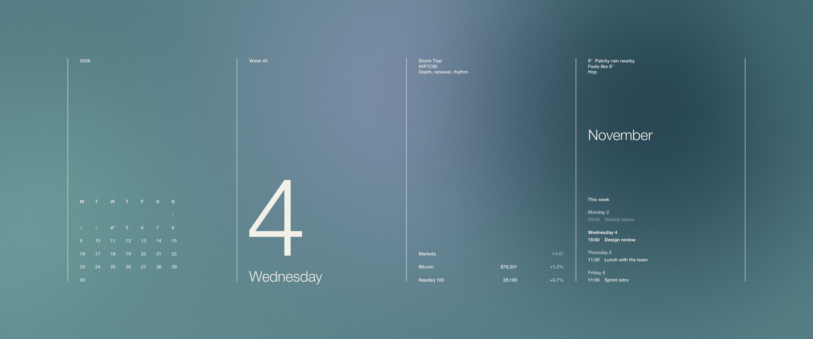

# daywall

A calendar wallpaper for macOS that changes colour with the day and the weather.



I saw a wallpaper like this and wanted one that kept itself up to date, so this renders a new one every 15 minutes with the month, the date, the weather, a couple of market prices and whatever meetings I have this week.

On clear days the colour follows the sun, so you get first light in the morning, blue sky while the sun is up, golden hour before sunset and blue hour right after, with the warm colours sitting low like a horizon. Any other weather picks a colour family instead, so cloudy days get soft greys and lilacs and rainy days get teal and indigo, and the date picks which colour within that family you get so two cloudy days in a row don't look the same. When it's properly dark it goes dark. Every colour comes with a name, a hex code and three words of questionable meaning, for example "Quiet, depth, patience".

The weather comes from [MET Norway](https://api.met.no), which is the data behind yr.no and covers the whole world. Sunrise, sunset and how high the sun is are calculated locally.

It is one swift file with no dependencies. It uses Core Image for the gradients, Core Text for the type, and Helvetica Neue because it already ships with macOS.

## Install

You need macOS and the Xcode command line tools (`xcode-select --install`).

```sh
git clone https://github.com/bjornarvikhagen/daywall.git
cd daywall
./install.sh
```

This compiles it into `~/Library/Application Support/Daywall`, adds a LaunchAgent that runs it every 15 minutes and at login, and sets the wallpaper. Most runs do nothing, since it only redraws when something on the screen has actually changed.

## Settings

Pass these as environment variables to `install.sh`, and run it again whenever you want to change them.

```sh
DAYWALL_LOCATION="Oslo" \
DAYWALL_ICS="https://outlook.office365.com/owa/calendar/…/calendar.ics" \
DAYWALL_TICKERS="Bitcoin=BTC-USD,Nasdaq 100=^NDX,Gold=GC=F" \
DAYWALL_HERO="digit" \
./install.sh
```

- `DAYWALL_LOCATION` is the weather location, any city [wttr.in](https://wttr.in/:help) understands, which is only used to look up where you are. It defaults to locating you by IP, which gets confused if you're on a VPN.
- `DAYWALL_ICS` is the calendar feed for the week agenda. It gets saved to `~/Library/Application Support/Daywall/calendar-url`, which only you can read.
- `DAYWALL_TICKERS` are `Label=Symbol` pairs using [Yahoo Finance](https://finance.yahoo.com) symbols. It defaults to Bitcoin and the Nasdaq 100.
- `DAYWALL_HERO` is what goes in the second column. Your options are `digit` (the date and weekday, which is the default), `daylight` (hours of daylight and an arc showing where the sun is), `moon` (the moon phase), `next` (your next meeting) and `year` (how much of the year is gone, for when you need motivation).

## Outlook / Teams calendar

In Outlook on the web, go to Settings → Calendar → Shared calendars → Publish a calendar, pick "Can view all details" and copy the ICS link. Anyone with that link can read your calendar, so don't paste it anywhere public. Your IT department may also have turned publishing off, in which case good luck.

Recurring meetings, moved and cancelled occurrences and Outlook's Windows time zone names are all handled, so it should match what you see in Outlook.

## Previewing

To render to a folder without touching your wallpaper:

```sh
~/Library/Application\ Support/Daywall/daywall --preview ~/Desktop --size 3024x1964 \
  --weather snow --night --date 2026-12-24 --hero moon
```

`--at "2026-11-04 15:40"` pretends it's a specific moment, which is handy for seeing what golden hour looks like without waiting for it. `--force` redraws even when nothing has changed, and the log is in `~/Library/Application Support/Daywall/daywall.log`.

## Changing it

Everything is in [`daywall.swift`](daywall.swift). The colours are in `palettes`, each with a name, hex, mood words, a base colour, the colours that get blurred together and which weather it belongs to. The clear sky colours are the `sky…` palettes right below, which also say how high up on the screen each colour sits. The layout is in `render`. Run `./install.sh` again afterwards to recompile.

## Uninstall

```sh
./uninstall.sh
```

This removes the LaunchAgent and the data folder, including the saved calendar link, and opens wallpaper settings so you can pick something else.

## Known issues

macOS only sets the wallpaper on the Space you're currently on, so other Spaces catch up the next time it runs while you're there. Weather is cached for 30 minutes, prices for 10 and the calendar for 15, and if you're offline it uses whatever it fetched last.
